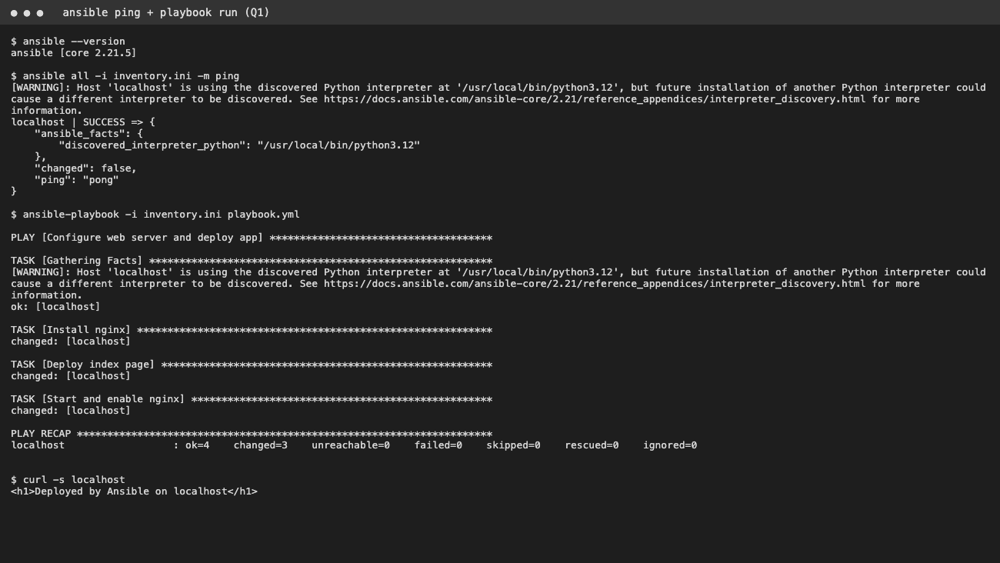

# Task 1 - Ansible
```
ansible all -i inventory.ini -m ping
ansible-playbook -i inventory.ini playbook.yml --syntax-check
ansible-playbook -i inventory.ini playbook.yml
curl localhost
```

## Output

