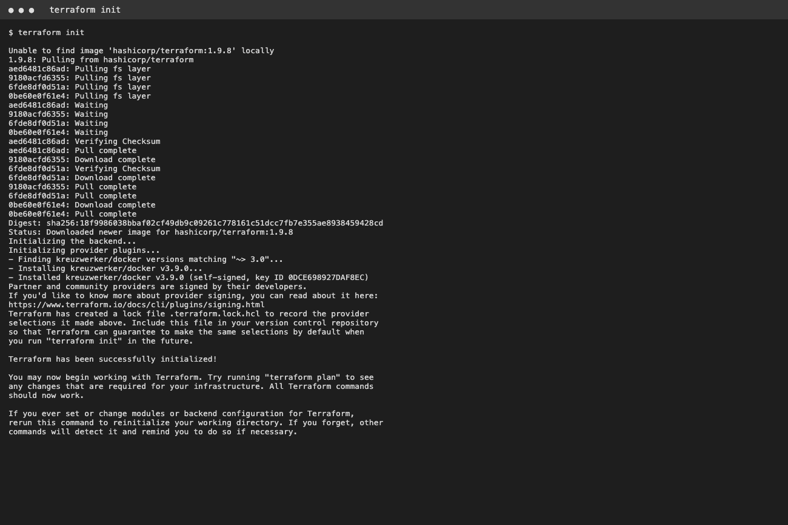
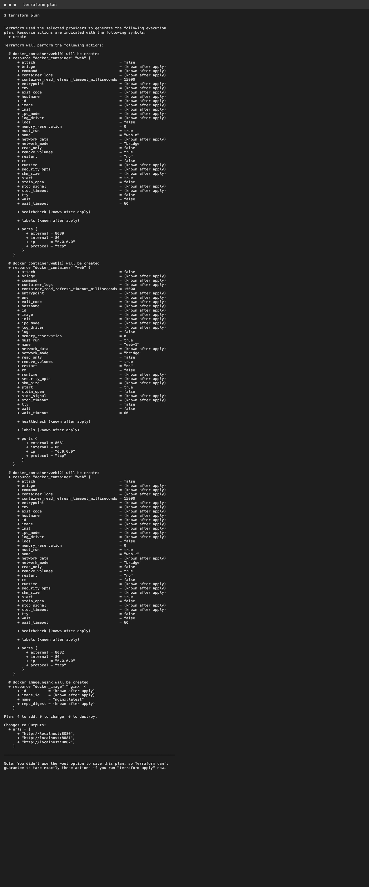
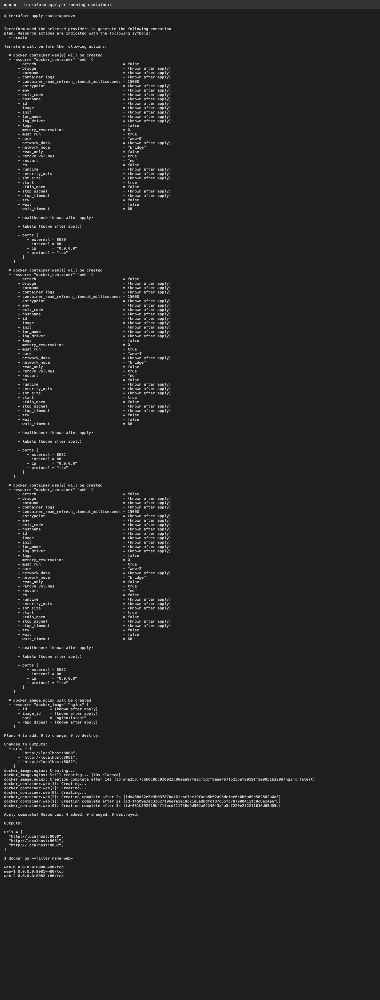

# Task 2 - Terraform (scalable: change `replicas`)
```
terraform init
terraform plan
terraform apply -auto-approve
terraform apply -var replicas=5   # scale out
terraform destroy
```

## Output




