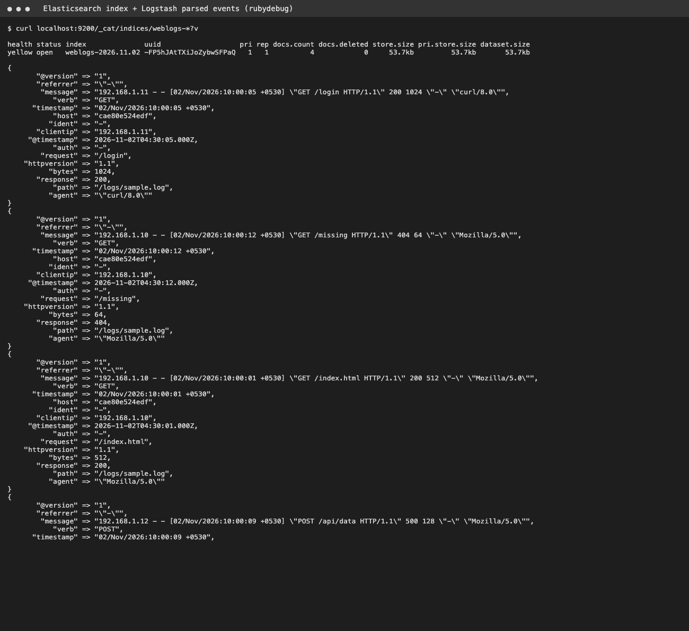
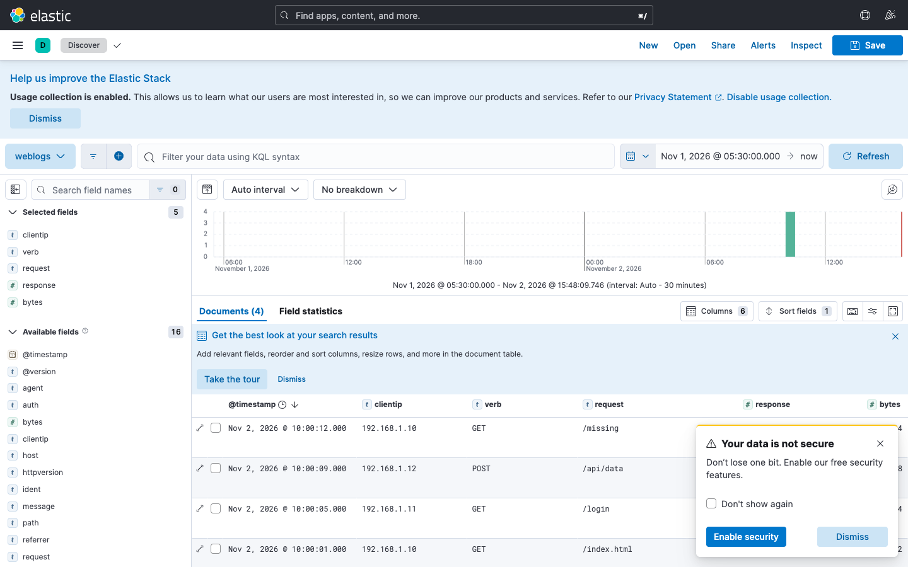
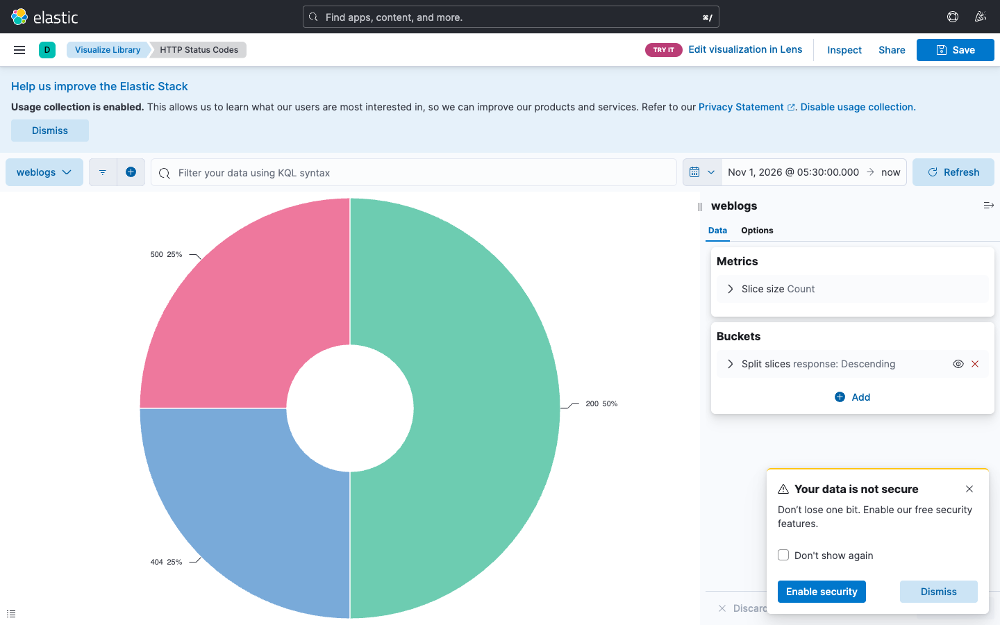

# Task 3 - ELK
```
docker compose up -d
curl localhost:9200/_cat/indices?v
```
Kibana: http://localhost:5601 -> Stack Management -> Data Views -> `weblogs-*` -> Discover / Visualize (status codes pie chart).

## Output



