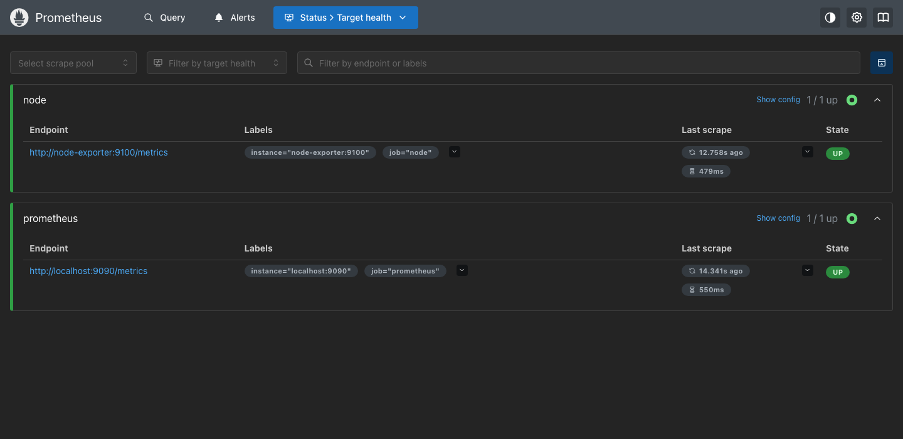
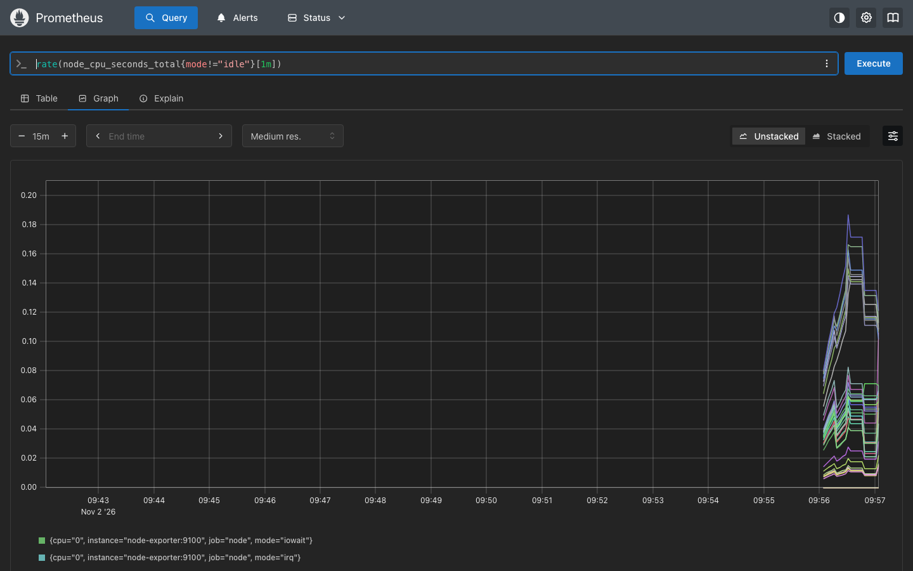
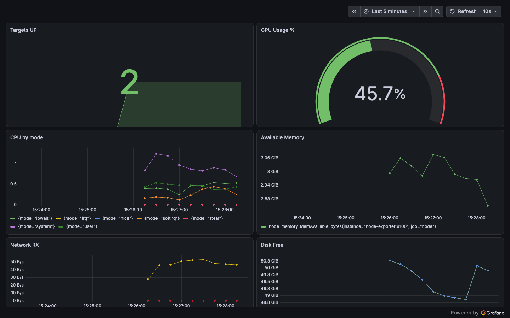

# Task 4 - Prometheus + Grafana
```
docker compose up -d
```
Prometheus: http://localhost:9090/targets (both UP). Grafana: http://localhost:3000 (admin/admin) -> Import dashboard ID **1860** (Node Exporter Full).
Sample queries: `up`, `rate(node_cpu_seconds_total{mode!="idle"}[1m])`, `node_memory_MemAvailable_bytes`.

A provisioned dashboard (`grafana/dashboards/node-metrics.json`) loads automatically at http://localhost:3000/d/node-metrics.

## Output



